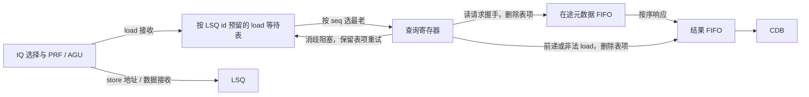

# 访存查询分级：请求所有权与重试（2026-10-23）

## 本轮范围

分支 `feat/freq-load-query-pipe`，基于隔拍唤醒 `819ddd1`。用户允许频率优先，
IPC / 面积暂时越线。本轮先切开 IQ/PRF/地址生成与 LSQ 查询，查询内部的
地址匹配及最年轻 store 选择暂时仍为组合逻辑。只跑 diagnose，不跑 opt。

## 状态与所有权

- store 从 IQ 直到地址预填或完整数据写入 LSQ；预填仍保留 IQ 表项，完整
  store 仍在接收拍完成，提交后才写内存。
- load 在 IQ/LSU 握手后由等待表负责，直到外部请求握手，或前递/异常结果
  进入结果队列。IQ 不再保存或重新发送这个 load。
- 查询寄存器只是表项的在途副本；对应等待表 valid 保留到执行接收，且
  选择逻辑排除该 id，防止重复发射。
- 未知地址或 partial store 阻塞时释放查询寄存器，等待表项保留并可重选。
- 内存 valid 等待 ready 时保持查询寄存器和地址；squash 可取消尚未握手的
  年轻请求。已握手的年轻请求保留元数据，响应返回后丢弃。

## 为什么不使用普通 FIFO

年轻 load 可能先就绪，却等待一个更老 store；这个 store 的源又可能依赖
更老但尚未就绪的 load。如果年轻 load 占住队头，或占满容量而让老 load
无法进入，就会形成循环等待。

本轮使用 `CPU_LSQ_DEPTH` 个按 LSQ id 索引的槽位。每条指令已有唯一且未释放
的 LSQ id，所以尚未就绪的老 load 已有自己的空槽，不会被年轻 load 挤占。
等待表按 dispatch seq 而非到达顺序选择，store 独立直填 LSQ；老 load 一旦
就绪即可进入并获得选择机会。满 IQ 中的就绪年轻 load 也能先离开 IQ 入表，
不会再因消歧阻塞而占住发射入口。

## 容量与恢复不变量

1. 每个 LSQ id 最多拥有一份等待 load；查询副本不能再次被选中。
2. 只在内存握手或本地结果成功入队后删除；retry 不删除。
3. `在途请求数 + 已返回结果数 <= LDQ_DEPTH`，发请求时为未来结果预留容量。
   即使 CDB 暂停，也不覆盖尚未广播的结果。
4. 内存响应按请求顺序配对；load 之间可乱序选择，依靠 tag 对应各自 ROB 项。
5. 待执行表与查询寄存器按 seq 丢弃年轻项；在途/结果队列继续按原机制 discard。
6. 同拍新 load 入表和旧 load 查询使用独立字段；MD/RQ 只能使用查询寄存器
   捕获的 tag / seq / id / size / offset / unsigned / illegal。
7. 接收 ready 不依赖 LSQ 查询结果；地址生成与查询之间存在实际寄存器边界。

## 验证

- W1/LSQ8、W2/LSQ16 LSU 专项分别 144 / 227 项通过。
- 整表年轻 load 等待老 store，晚就绪老 load 仍能进入和完成；store 地址
  预填及完整数据填入都能推进，年轻 load 随后前递完成且不重复读内存。
- 请求被内存反压时地址稳定；查询前、等待 ready 时及已发请求后的 squash。
- 字节前递保存 offset / signedness；非法 load 保留 tag / exception，不读内存。
- LSQ16 下 12 笔 load、8 个结果槽，CDB 停顿时最多发 8 笔，恢复后全部结果
  正确且无重复，不溢出。
- backend W1/W2 445 / 449 项通过；qsort/hanoi/queens 逐个通过。
- W1/W2 官方全量各 19/19 PASS；完整 suite ALL PASS；W2 / W1 IPC
  0.5419 / 0.5205。
- diagnose：19,706.842 µm² / 156.31 MHz，相对 `819ddd1` 频率 +45.3%，
  面积 +6.3%；没有运行 opt，未合入 main，tag `freq-load-query-pipe-20261023`。
- 第一条关键路径不再经过 IQ/PRF，LSQ 内部约 4.6 ns 查询及全局 squash
  路径仍需按时序报告继续评估。详见 `docs/experiments/load-query-pipe.md`。

## LSQ 内部匹配快照阶段（后续实验）

`feat/freq-lsq-snapshot` 基于上述检查点增加一级寄存器。q 级提交查询后，
LSQ 保存每个匹配候选的 seq/data/full 和匹配位；r 级同步保存 load 元数据。
平衡树只读快照，所有内存请求和本地结果只读 r 元数据。store 在跨拍期间
写完、释放或复用槽位不会改变响应。

q 与 r 可同拍推进；两级 id 都从等待表选择集合排除。消歧阻塞时释放 r
和快照，保留等待项重新查询；反压时保持两者。q/r 分别按 seq squash，
旧响应 flush 与新查询同时到达时新快照和新 r 优先，避免有效旧 load 被
清除或错配。直接 LSQ 专项和连续混合宽度前递用于验证这些边界。

本阶段测试与测量以 [LSQ 快照实验](../experiments/lsq-query-snapshot.md) 为准；
上节 156.31 MHz 与 IPC 0.5419/0.5205 为 `eb36c43` 基线，不能当作本候选结果。

## 等待 load 的平衡选择（后续组合优化）

`feat/freq-lsu-select-tree` 基于 `a239510`，将等待表逐项更新最老 seq/id 的扫描
改为平衡树。候选集合仍排除 q/r 已持有 id 和本拍 squash 的年轻项；同龄低 id
优先。树直接提供获胜 seq 给 q_seq，其他元数据按获胜 id 读取，不增加拍数。

反压填满、逆龄入队、置换物理 id、同龄及批量 squash 的专项测试检查外部请求
顺序、tag/data、无重复和可排空。测量结果以
[LSU 选择树实验](../experiments/lsu-select-tree.md) 为准；不改变本页的请求所有权、
预留容量、阻塞重试和恢复不变量。
